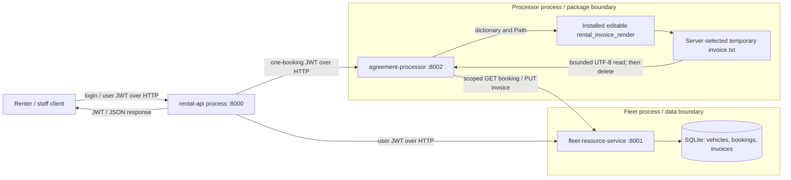
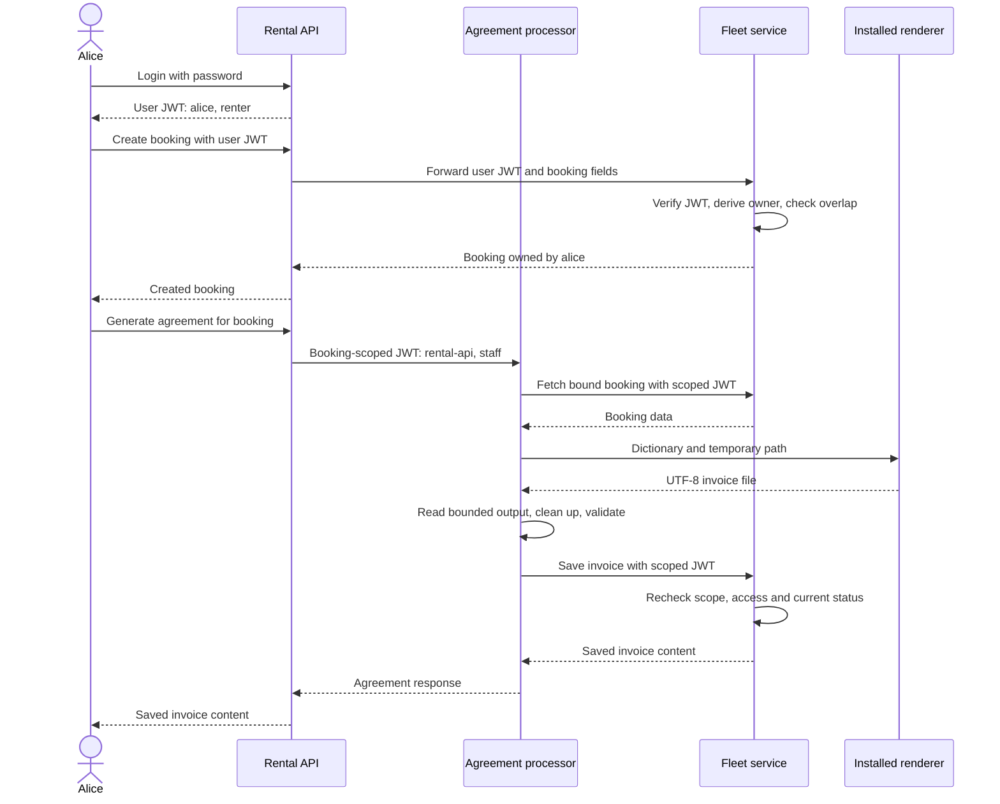
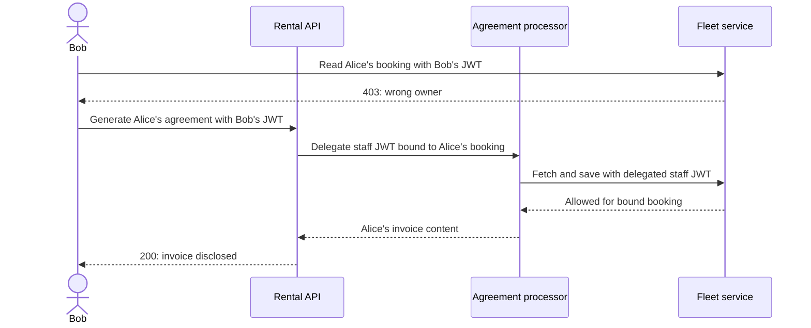

# Secure Car Rental: Design, Development and Security Evaluation

## 1. Purpose and system boundaries

A car-rental system provides a small but useful setting for studying authorization.
Renters share the vehicle catalogue but must not share control of their bookings.
Staff need broader permissions, and invoice generation requires another component
to act on a renter's behalf. These differences make identity, ownership and
delegated authority visible without introducing payment processing or a large
account-management system. The project is a teaching implementation, not a
production rental platform. It deliberately contains four vulnerabilities whose
behavior is documented and tested.

The system has three FastAPI services. The rental API authenticates users and
coordinates requests. The fleet resource service owns vehicles, bookings and
invoices in SQLite. The agreement processor obtains booking data, invokes an
external invoice renderer and returns the generated agreement through fleet.
Separating these responsibilities makes it possible to test whether authorization
survives a service boundary, rather than assuming that reaching an internal
endpoint proves permission. The [threat model](threat-model.md) records the
boundaries and assets; the [access-control matrix](access-control-matrix.md)
states the intended permissions and intentional exceptions.

Only fleet opens the database. This keeps ownership and booking-state decisions
beside the data they protect. The processor receives no database connection and
cannot submit arbitrary database operations. The renderer is a separately
installed editable Python package, demonstrating a dependency boundary rather
than another network service. This separation is architectural, not complete
isolation: services share an HS256 signing key, and the renderer executes inside
the processor with its operating-system privileges.

### Architecture and trust boundaries

### Repository map

| Location | Responsibility |
| --- | --- |
| [README](../README.md) | Installation, service startup, API examples, manual vulnerability demonstrations and validation commands |
| [Authentication](../app/auth.py) | JWT creation, claim validation, scope restrictions and staff dependency |
| [Rental API](../app/rental_api/main.py) and [HTTP helper](../app/http.py) | Demo login, forwarding, delegation and downstream error handling |
| [Fleet service](../app/fleet_resource_service/main.py) and [database](../app/fleet_resource_service/db.py) | Resource authorization, schema, seeding and transactions |
| [Agreement processor](../app/agreement_processor/main.py) and [renderer](../external/rental_invoice_render/rental_invoice_render/__init__.py) | Booking validation, temporary output and invoice formatting |
| [Tests](../tests/conftest.py) | Three-process fixture, temporary database and generated credentials |
| [Lifecycle plan](lifecycle-plan.md), [STRIDE](stride-analysis.md) and [workflow](../.github/workflows/ci.yml) | Development decisions, threat analysis and automated checks |
| [Requirements](../requirements.txt) and [package configuration](../pyproject.toml) | Pinned dependencies, build requirements and service packaging |

## 2. Identity, authority and ownership

Identity is established at login, not by a user identifier supplied in a booking
request. The [rental API](../app/rental_api/main.py) defines Alice and Bob as
renters and Carol as staff. Environment-provided passwords are converted to salted
PBKDF2-HMAC-SHA256 hashes using 600,000 iterations. Password comparisons use
`compare_digest`; unknown users receive the same response as incorrect passwords.
These measures protect the demo login path, but do not provide account recovery,
password rotation or a persistent identity service.

Successful login issues a JWT containing subject, role, issue time and expiry.
The [authentication module](../app/auth.py) restricts verification to HS256,
requires those claims and limits token lifetime to 900 seconds. Every service
verifies incoming credentials independently. A signature establishes that a
holder of the shared key issued the claims; it does not establish that the claims
represent an appropriately limited delegation. That distinction explains the
confused-deputy vulnerability discussed below.

Booking ownership is established by fleet from the verified subject. Request
models reject extra fields, so clients cannot choose another owner or set the
initial status. Fleet defaults bookings to `pending`, calculates prices from
stored rates and saves integer cents. Its `accessible_booking` dependency checks
the requested booking against both token scope and owner/staff authority. Normal
reads and cancellation use that dependency. Client-supplied identity headers do
not replace the signed identity.

Dependency trust is established through the pinned
[requirements](../requirements.txt), package build configuration and installation
procedure. Installation disables automatic dependency resolution, checks build
requirements and runs `pip check`. GitHub Actions are pinned to commit hashes.
These measures constrain inputs and expose incompatibilities, but neither version
pins nor vulnerability scans prove package provenance. The editable renderer is
still trusted executable code, not a sandboxed document conversion service.

## 3. Three design principles

**Least privilege** appears in the distinction between user and agreement tokens.
`user_only` rejects scoped processor credentials on general routes;
`agreement_only` rejects ordinary user tokens at the processor. Agreement claims
bind one positive booking ID, and delegated expiry cannot exceed the caller's.
The processor can fetch that booking and save its invoice, but cannot enumerate
bookings, manage vehicles or cancel reservations. The authorization suite's
[`test_least_privilege`](../tests/test_authz.py) exercises these restrictions directly. However, the API's
delegated staff role violates least privilege within the selected booking: limited
scope does not make an excessive role safe.

**Complete mediation** appears in fleet's repeated authentication and resource
checks. Requests forwarded by the API do not bypass fleet verification. The
processor also checks the path's booking ID against its token, validates returned
booking data and checks ownership for renter-scoped credentials. Invoice saving
rechecks cancellation inside a transaction, rather than assuming that a booking
remains valid throughout rendering. `test_complete_mediation` demonstrates that
direct requests, forged identity headers and a wrong-owner scoped token do not
defeat the normal checks. The override-cancellation route is an explicit exception
and shows why checking most routes is insufficient.

**Fail-safe defaults** appear in rejected missing, malformed and expired tokens,
startup rejection of missing or short signing keys, and the database's initial
booking status. Callers cannot request a more favorable status through extra
fields. The processor rejects invalid upstream data, empty invoices and output
exceeding 100,000 characters instead of saving an apparently successful result.
`test_fail_safe_defaults` checks authentication rejection and booking defaults.
These are bounded claims about particular paths, not proof that every failure
mode is tested. The [principle matrix](access-control-matrix.md) links the three
principles to implementation and tests.

## 4. Authority through the agreement workflow

For ordinary fleet operations, the rental API forwards the caller's bearer token
unchanged. Agreement generation differs: the API issues a short-lived,
single-booking token and sends it to the processor. The processor forwards that
credential to fleet for booking retrieval and invoice storage. Ownership in the
invoice comes from fleet's booking record, not from a client-supplied name.

The checks prevent a valid processor credential from being reused against another
booking or a bulk endpoint. They also reject a normal user credential presented
directly to the processor. Nevertheless, the actual delegation uses
`sub="rental-api"` and `role="staff"` for every caller. Bob can therefore request
Alice's agreement: fleet accepts the delegated staff role, and the API returns
the invoice content. Direct reads and later invoice retrieval still deny Bob.

`test_agreement_confused_deputy_composition_demo` verifies this contrast, including
the persisted invoice. The lesson is that authorization must constrain the
delegation itself, not merely validate its signature after privilege has already
been amplified.

## 5. Development plan and gate decisions

The initial lifecycle plan preceded feature code in commit
[`466fca9`](https://github.com/Tedas1/SoftwareSecurityA1/commit/466fca9).
Implementation then separated scaffolding, fleet persistence, API authentication
and agreement processing before
[formal integration tests were added](https://github.com/Tedas1/SoftwareSecurityA1/commit/b4dbb37). This order
made the database owner and authority flow explicit before the cross-service
workflow was complete. The current [plan](lifecycle-plan.md) organizes the work
into requirements, implementation/build, testing, and release/operation.

Requirements produced the asset register, access matrix and STRIDE analysis.
Implementation translated those decisions into verified JWT dependencies,
single-booking delegation and fleet-owned state changes. Testing added executable
evidence for normal workflows and authorization boundaries.
[CI](https://github.com/Tedas1/SoftwareSecurityA1/commit/2ebf6b6) then made
installation, linting, source scanning, dependency auditing and test execution
repeatable. The later
[vulnerability commit](https://github.com/Tedas1/SoftwareSecurityA1/commit/564e265)
changed the security baseline; the
revised documentation must therefore describe those exceptions rather than
continue claiming universally enforced ownership.

Gate decisions distinguish correct execution from acceptable security. A passing
test can demonstrate an intentional exploit, while a failing scanner can correctly
identify the planted SQL injection. The project keeps that finding unsuppressed.
Consequently, passing functional tests is not a release decision, and an expected
security failure must not be relabeled as a green build. Commit history supports
the development sequence; actual logs are needed to support execution results.

One gate also became stricter: the initial plan targeted high/critical dependency
findings, whereas the implemented pip-audit command fails on any known audited
vulnerability. No custom severity filter was introduced. This change avoids
treating an unavailable severity rating as permission to pass.

STRIDE connects those decisions to particular assets and consequences. Spoofing
threatens identity claims, so signature and claim checks belong at each HTTP
boundary. Tampering threatens booking terms and stored data, motivating
server-derived prices and transaction checks. Repudiation exposes the absence of
a durable actor history, while information disclosure includes the demonstrated
invoice leak. Denial of service remains only partly addressed by timeouts and
bounded reads. Elevation of privilege includes both excessive delegation and
override cancellation. Recording affected assets and impacts prevents a scan
result from becoming the entire security assessment: several important failures
are business-authorization errors that require workflow tests and manual review.

## 6. CI substitution and verification evidence

GitHub Actions was used instead of Jenkins. Both serve the same purpose here:
orchestrating repeatable build, security and test checks and retaining their
results. This is a substitution of the CI platform, not a claim that their
configuration formats, administration or security models are identical. The
repository implements the pipeline in a
[workflow](../.github/workflows/ci.yml), rather than a Jenkinsfile. Pushes and pull
requests trigger independent build and test jobs on hosted Ubuntu runners.

The build job installs pinned requirements and both editable projects, runs
`pip check` and Ruff, then executes Bandit and pip-audit. Audit findings are not
severity-filtered or suppressed. Scan steps can still run after an earlier check
fails if installation succeeded. The test job starts the three services with a
temporary SQLite database, generated passwords and a generated signing key.
[Fixtures](../tests/conftest.py) isolate runtime data and stop the processes they
created. Tests exercise real HTTP boundaries rather than only mocked calls.

The pipeline attempts to retain `bandit.json` and `pip-audit.json` as
`build-reports`, and JUnit XML plus console output as `pytest-results`, even after
failures. This makes failure investigation part of the gate rather than discarded
console history. Read-only repository permissions, disabled checkout credential
persistence and action commit pins reduce unnecessary CI authority.

The [Actions page](https://github.com/Tedas1/SoftwareSecurityA1/actions/workflows/ci.yml)
is the location for hosted execution evidence. It returned HTTP 404 during this
report's preparation, so no hosted run ID, job conclusion or artifact contents
were independently verified. Local checks are documented separately below; they
must not be presented as GitHub Actions results or proof of a clean hosted build.

The [local verification log](report-verification.txt) records 22 passing tests,
successful Ruff and dependency-consistency checks, and Bandit's failing B608
finding. pip-audit exited successfully with no known findings for audited
dependencies, but skipped the two local project distributions because they are
not on PyPI. It therefore does not establish their security. These checks used
the existing Python 3.14.0 Windows environment, not a fresh installation or the
workflow's pinned Python 3.14.9 Ubuntu environment.

## 7. Planted vulnerabilities and their impact

**Improper input validation (CWE-20).** Fleet's `VehicleInput` checks name length
but does not trim or reject whitespace-only names. Staff can persist a vehicle
named with three spaces. The [functional demonstration](../tests/test_functional.py) confirms both acceptance
and storage while checking that other invalid fields remain rejected. The impact
is misleading or unusable catalogue data, not an authentication bypass. A fix
would normalize names and reject values that become empty.

**SQL injection (CWE-89).** Vehicle search constructs its SQL statement using an
f-string containing the search term. API URL encoding preserves the parameter in
transit but does not make it safe for SQL. The demonstration changes a search
with no expected match into one returning every vehicle. That proves query
manipulation, not arbitrary database writes or complete database extraction.
Parameterized search would remove the injection path; Bandit's B608 finding is
expected to block the security gate while this code remains.

**Missing authorization (CWE-862/IDOR).** Override cancellation authenticates the
caller but does not require staff status or ownership. Bob can cancel Alice's
booking through either exposed service, although normal cancellation returns
403. The test verifies the changed stored status, not merely a success response.
The impact is unauthorized reservation disruption. The route needs an explicit
staff requirement enforced at fleet, with matching API checks and regression
tests.

**Confused deputy (CWE-441).** Agreement generation grants the API's staff role
to a caller-selected booking without establishing that caller's access first.
The result is cross-renter invoice disclosure and an unauthorized invoice write.
The fix should preserve the caller's authorized subject and role, or perform an
explicit ownership/staff check before issuing a narrowly defined capability.
Fleet must still enforce access independently. All four flaws have automated
demonstrations and manual reproduction steps in the [README](../README.md);
their presence is intentional, but their consequences remain security failures.

## 8. Protection layers and production changes

Python provides memory-managed execution and standard cryptographic and temporary
file facilities, but does not prevent SQL injection or incorrect authorization.
FastAPI dependencies make repeated checks reusable; Pydantic validates claims,
identifiers, dates and body shapes; PyJWT verifies signatures and time claims.
SQLite supplies constraints and transactions. Fleet's `BEGIN IMMEDIATE` protects
the overlap-check-and-insert sequence: the concurrency test expects one booking
and eleven conflicts from twelve simultaneous requests. That guarantee comes
from application transaction design, not from using Python alone.

Application logic supplies owner checks, role checks, price snapshots, booking
scope and invoice validation. The shared HTTP helper limits downstream calls to
ten seconds and distinguishes unreachable services from timeouts. Local startup
binds services to loopback and obtains secrets outside source control. Neither
loopback nor separate processes supplies TLS, distinct signing authority or a
global resource limit. The renderer's 100,000-character output check bounds the
accepted invoice text, not the renderer's CPU time or all disk consumption.

Coverage also has limits. The integration suites demonstrate the normal agreement
flow, access boundaries, booking concurrency and four planted flaws. They do not
establish exhaustive coverage of every malformed upstream response, filesystem
failure or cancellation race. Those branches can be inspected in the processor
and fleet code, but inspection is different evidence from an executed fault test.
Production verification should add targeted fault injection, sustained-load tests
and recovery exercises rather than infer these properties from a successful
happy-path invoice test.

A production release must first remove the four planted flaws and reverse the
exploit tests into rejection tests. It also needs managed identities or
service-specific credentials, issuer/audience constraints, key rotation and
revocation, TLS, and protected secret distribution. Login needs rate limiting
and a real account lifecycle. Invoice access, retention and deletion need an
explicit policy, with audit records identifying who created or cancelled a
booking. Resource limits and renderer isolation should contain dependency
failure or compromise.

Operational work also includes tested backups and recovery, database capacity
assessment, monitoring and named owners for dependency updates. Scanner results
must be triaged without hiding failures, and authorization should be retested
whenever routes or delegation change. The main conclusion is therefore limited
but concrete: the repository demonstrates useful controls and reproducible
counterexamples, not production readiness. Its strongest evidence is the
combination of traceable commits, readable authority checks and tests that show
exactly where those checks hold and where they fail.

## Appendix A. Verification record

The [verification log](report-verification.txt) was generated on 23 October 2026. The checks did not modify
application code or use the persistent runtime database. Hosted CI results remain
unverified for the reason stated in Section 6.

| Local check | Result | Exit code | Interpretation |
| --- | --- | --- | --- |
| `python -m pip check` | No broken requirements | 0 | Installed dependency metadata is consistent; not a clean-install proof |
| `python -m ruff check .` | All checks passed | 0 | Configured lint checks passed |
| `python -m pytest -q tests/test_functional.py tests/test_authz.py` | 22 passed in 58.62 seconds | 0 | Normal behavior and intentional flaw demonstrations passed |
| `python -m bandit -r app` | One B608 finding, medium severity and confidence, at [fleet search](../app/fleet_resource_service/main.py#L87) | 1 | Source-security gate fails on the planted CWE-89; zero suppressed lines |
| `python -m pip_audit --progress-spinner off --timeout 15` | No known vulnerabilities in audited dependencies; two local packages skipped | 0 | Successful audit with incomplete coverage of local code |

The combined local outcome is **not a security-gate pass** because Bandit failed.
No CI artifact or hosted job result is inferred from these local commands.