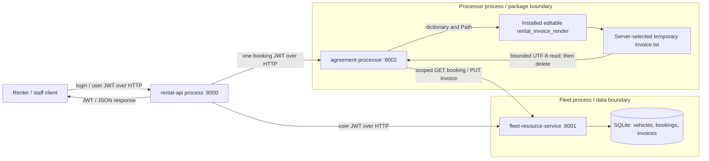

# Threat model

## Scope and assets

Three services communicate over loopback HTTP. Only fleet opens SQLite.
The [access-control matrix](access-control-matrix.md) lists permissions and
intentional authorization flaws.

| Asset | Owner / location | Security objective |
| --- | --- | --- |
| Passwords and signing key | Environment; rental API holds salted password hashes | Keep secrets private; assign roles server-side |
| JWTs | Rental API issues; each service verifies | Signed identity and role, 900-second maximum lifetime, booking scope |
| Vehicles and bookings | Fleet SQLite | Authorized changes, owner isolation, fixed prices, no overlapping pending bookings |
| Invoices | Processor temporary file; saved copy in fleet SQLite | Correct booking, controlled paths, authorized reads and writes |
| Source and dependencies | Git, pinned requirements, CI artifacts | Traceable versions, repeatable installation, saved test and scan results |

## Components and trust boundaries

| Boundary | Rule |
| --- | --- |
| Client -> rental API | Server-defined login roles; other domain routes require a user JWT. |
| Rental API -> processor | Delegates `sub="rental-api"`, `role="staff"` regardless of caller role (CWE-441). Booking scope and expiry still apply, but renters can generate each other's invoices. |
| HTTP caller -> fleet | Rechecks JWT and scope. Role/ownership checks apply except on override cancellation (CWE-862); caller location and raw identity headers grant no access. |
| Fleet -> SQLite | Only fleet opens the database. Writes are parameterized and booking creation is serialized, but vehicle search interpolates SQL (CWE-89). |
| Processor -> renderer/filesystem | Passes a dictionary and private temporary path, validates output, then saves through fleet. The renderer runs with processor privileges, without a sandbox. |
| Repository -> CI/dependencies | Installs pinned versions without extra dependencies, checks packages, runs scans, and uploads reports. Tests use generated credentials. |

## Agreement flow and authority

1. Alice logs in. The API checks her password hash and issues a JWT with
   `sub`, `role`, `iat`, and `exp`.
2. Alice books a vehicle. Fleet verifies the token, takes ownership from `sub`,
   stores the price, and defaults status to `pending`.
3. For agreement generation, the API delegates a booking-scoped staff token,
   regardless of caller role. Bob can therefore generate Alice's invoice.
   The processor checks signature, expiry, scope, and booking ID.
4. The processor fetches the booking. Fleet checks token binding and owner/staff
   access, trusting the delegated staff role.
5. The processor validates data, renders, reads and removes the temporary file,
   then saves through fleet. Cancellation before saving returns 409.
6. Alice retrieves the saved invoice; fleet checks ownership. The processor
   cannot list bookings, and the invoice owner comes from the booking.

Cancelled bookings retain existing invoices but cannot generate new ones.
See [STRIDE](stride-analysis.md) and [authorization tests](../tests/test_authz.py).

## Assumptions and gaps

Maintainers and the host are trusted. A compromised service or renderer can read
its environment; any holder of the shared HS256 key can mint tokens.
TLS, key rotation/revocation, rate limits, durable audit logs, invoice retention,
backup/recovery policies, and dependency provenance checks are not implemented.
