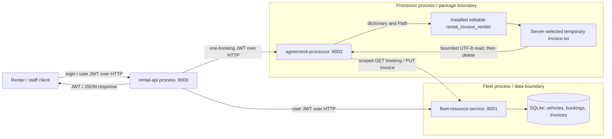

# Threat model

## Scope and asset register

The demo runs three separate processes over loopback HTTP. Only fleet opens the
SQLite database. Renters own their bookings; staff have fleet and all-booking
authority. The [matrix](access-control-matrix.md) defines individual operations.

| Asset | Owner / location | Security objective |
| --- | --- | --- |
| Demo passwords and JWT signing key | Environment configuration; rental account map holds salted hashes; services verify with the shared key | Keep private; derive roles server-side; no embedded key or logged credentials |
| JWT identity/authority | Rental issues; each service verifies | Signed subject/role, at most 900 seconds, booking-bound processing |
| Vehicles and bookings | Fleet SQLite | Authorized changes, owner isolation, pending defaults, price integrity and non-overlap |
| Invoice text and temporary output | Processor temporary file; canonical copy in fleet SQLite | Correct booking/owner, controlled paths, authorized retrieval and write-back |
| Source, dependencies and build/test evidence | Git, pinned manifest and Actions artifacts | Traceable inputs, repeatable installation and authentic saved results |

## Components and trust boundaries

| Boundary | Rule |
| --- | --- |
| Client -> rental API | Treat input as untrusted. Login roles are fixed server-side; all other domain routes require a verified user JWT. |
| Rental API -> processor | Replace the general token with one booking-scoped token retaining the initiating subject/role; expiry cannot exceed the caller's expiry. |
| Any HTTP caller -> fleet | Verify JWT again and enforce scope, ownership and role. Network origin and raw user/role headers do not grant authority. |
| Fleet -> SQLite | Only fleet application code opens it; use parameterized SQL and serialized booking creation. Host/DB administrators remain trusted. |
| Processor -> external package/filesystem | Import the separately installed package, pass a dictionary and private temporary path, validate output, then save through fleet HTTP. The package executes with processor privileges; it is not sandboxed. |
| Repository -> CI/dependency sources | Install listed versions in a fresh environment without automatic dependency additions; validate requirements, scan, and upload real outputs. No production credentials are supplied to tests. |

## Agreement flow and authority

1. Alice logs in; rental API checks the environment-configured account hash and
   issues a user JWT with `sub`, `role`, `iat`, `exp`.
2. Alice creates a booking through the API. Fleet verifies the JWT, takes
   ownership from `sub`, captures the total price and defaults to `pending`.
3. API receives generation for that booking and sends only a scoped JWT to the
   processor. Processor independently verifies signature, expiry, scope and ID.
4. Processor fetches exactly one booking from fleet using the scoped token.
   Fleet rechecks binding and renter ownership (or explicit staff authority).
5. Processor validates the response, renders via the external package, reads the
   text, removes the temporary file and sends a scoped invoice write to fleet.
   Fleet checks current status again; cancellation during rendering returns 409.
6. Alice retrieves the stored text through the API; fleet rechecks ownership.
   Staff may initiate processing for a renter, but the invoice owner comes from
   the booking, and the processor still cannot enumerate records.

Existing invoices stay readable after cancellation; new generation is denied.
Malformed data/output and upstream failures do not produce success responses.
See [STRIDE](stride-analysis.md) and the [principle tests](../tests/test_authz.py).

## Assumptions and production gaps

Source maintainers and the local host are trusted. A malicious package or
compromised service can access its process environment; sharing HS256 keys does
not constrain a compromised signer. Production would need TLS, independently
scoped verification/signing authority, key rotation/revocation, managed passwords
and abuse controls, durable audit logs, filesystem/DB protections, invoice
retention, backups/recovery, concurrency planning and dependency provenance.
These are report topics, not extra demo features or a production-readiness claim.
